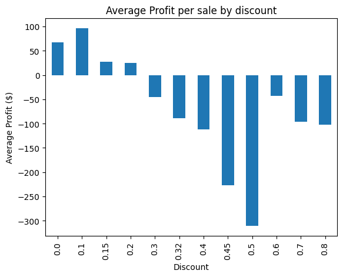

# superstore-profit-analysis
# Superstore Profit Analysis

Python and pandas analysis of 9,994 retail sales, to find where the company loses money and whether heavy discounts are the cause.

## Question
Which sales lose money, and are heavy discounts the reason?

## Data
Sample Superstore sales dataset from Kaggle (9,994 sales, 13 columns). Amounts are in US dollars. The CSV is not included here.

## Key findings
- The company earned about $286,000 in total profit.
- 18.7% of sales (1,871) lost money.
- Profit per sale is positive up to a 20% discount and turns negative at 30%.
- 1,393 sales with a discount of 30% or more lost about $135,000, while the other 8,601 sales earned about $422,000.
- Tables are the biggest loss-making product type (about -$17,700). Tables sold below a 30% discount earned about $13,000, while those at 30% or more lost about $31,000.

## Charts

## Recommendation
Limit discounts to below 30%, starting with Tables. The data shows losses are concentrated in heavily discounted sales, but it does not prove discounts are the only cause.

## Tools
Python, pandas, matplotlib, Google Colab

## Files
- `Superstore Analysis.ipynb`: the full notebook with code and outputs
